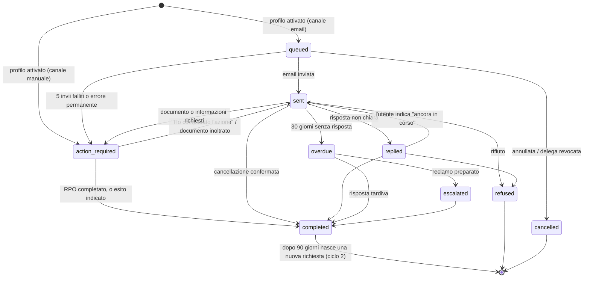

# 3 · Ciclo di vita delle richieste

Una **richiesta** è l'atto con cui un profilo chiede la cancellazione a un soggetto. Ogni profilo attivo ha una
richiesta per ogni soggetto contattabile del registry, più quelle personalizzate.

## Come nasce una richiesta

Quando attivi un profilo (`POST /profiles/:id/activate`) il sistema crea una richiesta per ogni voce del registry
con invio automatico abilitato (`sendEnabled`). Per ciascuna sceglie il canale:

| Il soggetto ha... | Canale | Stato iniziale |
|---|---|---|
| un indirizzo **email** | Email automatica | `queued` (in coda) |
| solo un **modulo web** | Azione manuale (`manual_form`) | `action_required` |
| solo un **telefono** | Azione manuale (`manual_steps`) | `action_required` |
| solo una **PEC** | Azione manuale: la PEC accetta solo messaggi da PEC | `action_required` |
| Registro delle Opposizioni | Azione manuale guidata (`manual_steps`) | `action_required` |
| nessun recapito utilizzabile, o è il Garante | Nessuna richiesta | – |

La creazione è **idempotente**: per ogni coppia profilo/soggetto/ciclo esiste una sola richiesta, quindi riattivare
o ripetere l'operazione non crea duplicati. Se il registry guadagna nuovi soggetti abilitati, lo scheduler li
aggiunge ai profili già attivi (a lotti di 20 profili per giro).

## Stati

| Stato | Gruppo in app | Significato |
|---|---|---|
| `queued` | In corso | In coda per l'invio automatico |
| `sent` | In corso | Inviata, in attesa di risposta (30 giorni) |
| `replied` | In corso | Risposta ricevuta ma non classificabile: decide l'utente |
| `overdue` | In corso | Scaduto il termine senza risposta |
| `escalated` | In corso | Bozza di reclamo al Garante preparata |
| `action_required` | Azione richiesta | Serve l'intervento dell'utente (vedi motivi sotto) |
| `completed` | Completate | Cancellazione confermata |
| `refused` | Non rimovibili | Il soggetto ha rifiutato |
| `cancelled` | Non rimovibili | Annullata (dall'utente o per revoca della delega) |

Motivi di `action_required` (`actionReason`): `manual_form` (modulo web), `manual_steps` (telefono, PEC, RPO o invio
automatico fallito), `id_required` (il broker chiede un documento), `more_info` (chiede altre informazioni),
`reply_review` (l'utente ha chiesto di rivedere).

Le transizioni sono validate nel codice (`src/requests/status.ts`): un passaggio non ammesso risponde `409` con
codice `INVALID_STATE`. Gli stati finali (`completed`, `refused`, `cancelled`) non tornano indietro: un rinnovo crea
una **nuova** richiesta.

## L'invio

L'invio delle richieste email è regolato da una **coda asincrona gestita con BullMQ e Redis** (`DispatchQueueService`),
con il coordinamento dello scheduler periodico. Le richieste non partono tutte all'istante, ma vengono scaglionate
secondo una politica di equità (**Fair-Share**) e protezione delle quote del fornitore:

- **Scaglionamento per utente (massimo 5 al giorno):** All'attivazione del profilo o all'aggiunta di richieste, le email
  vengono calendarizzate a blocchi di massimo 5 al giorno per utente (`USER_DAILY_REQUEST_LIMIT=5`). Il primo blocco
  parte oggi (distanziato di alcuni secondi per evitare raffiche), il secondo dopo 24 ore, il terzo dopo 48 ore, e così via.
- **Protezione quote Resend (100/giorno, 3000/mese):** Il sistema tiene traccia dei volumi complessivi. A 95 email inviate
  nella giornata, le richieste massive si mettono automaticamente in pausa per riservare le ultime 5 email a comunicazioni
  critiche di sistema (verifiche account, reset password). I job residui vengono rischedulati a domani senza errori.
- **Mittente:** `Cancellamy per conto di Nome Cognome <indirizzo MAIL_FROM>`.
- **Rispondi a:** un indirizzo per profilo, `r-<token>@INBOUND_DOMAIN`, che permette di collegare le risposte.
- **Oggetto:** `Richiesta di cancellazione e opposizione (artt. 17 e 21 GDPR) - Nome Cognome [CNC-XXXXXXXX]`.
- **Allegato:** `delega.pdf` firmata.
- **Testo:** italiano se il broker è italiano (sede IT o dominio `.it`), inglese altrimenti. Include artt. 17, 21 e 19,
  la richiesta di riscontro entro un mese, i soli dati identificativi forniti dall'utente, l'invito a non chiedere
  documenti se non indispensabili (minimizzazione) e l'avviso del possibile reclamo al Garante.
- **Idempotenza:** ogni invio usa una chiave (`req-<id>-erasure`) così il fornitore non recapita due volte lo stesso
  messaggio, anche se l'operazione viene ripetuta.

### Perché questa limitazione è essenziale
1. **Evitare il blocco dell'account email:** Rispettare rigorosamente il tetto di 100 email/giorno e 3000 email/mese di Resend.
2. **Prevenire il monopolio da parte di un singolo utente:** Senza questo limite, un solo utente che attiva un profilo con oltre 360 broker consumerebbe immediatamente la quota di 3 giorni e mezzo per l'intera piattaforma.
3. **Tutela della deliverability e antispam:** I provider email e i broker destinatari penalizzano fortemente i domini che generano picchi anomali istantanei. L'invio dilazionato assicura che le richieste vengano lette e lavorate regolarmente.

### Se l'invio fallisce

| Errore | Comportamento |
|---|---|
| Transitorio (rete, limite di frequenza, 5xx) | Nuovo tentativo con attesa crescente (2, 4, 8, 16 minuti) |
| Dopo 5 tentativi, o errore permanente (indirizzo non valido...) | La richiesta diventa `action_required` con istruzioni manuali e arriva una notifica |
| Profilo in pausa o delega revocata | Non si invia; riprende alla riattivazione |

## Le risposte

I broker rispondono a `r-<token>@INBOUND_DOMAIN`. Il fornitore email avvisa l'API con un webhook
(`email.received`, firma verificata, consegne deduplicate). L'API:

1. identifica il profilo dal token dell'indirizzo;
2. trova la richiesta, in quest'ordine: **riferimento `CNC-…`** nell'oggetto o nel testo → **dominio del
   mittente** se c'è una sola richiesta aperta verso quel dominio;
3. se non trova nulla, o l'autenticazione del mittente (DMARC) fallisce, mette il messaggio nella **posta non
   abbinata** per un amministratore;
4. ignora il testo citato (le risposte spesso ripetono la nostra email) e **classifica** il contenuto.

| Classificazione | Esempi (italiano e inglese) | Effetto |
|---|---|---|
| `completed` | "abbiamo provveduto alla cancellazione", "your data has been erased" | Stato `completed`; verifica tra 90 giorni |
| `refused` | "obbligo di legge", "legittimo interesse", "we do not hold any data" | Stato `refused` |
| `id_required` | "copia del documento di identità", "verify your identity" | `action_required` (`id_required`) |
| `more_info` | "ulteriori informazioni", "please provide" | `action_required` (`more_info`) |
| `auto_reply` | "abbiamo ricevuto la tua richiesta", "out of office" | Solo registrata: lo stato non cambia |
| `unknown` | tutto il resto | `replied`: l'utente decide |

La classificazione è **euristica**: l'utente può sempre correggere l'esito dalla pagina della richiesta.

## Scadenze e solleciti

- La scadenza è di **30 giorni** dall'invio (`RESPONSE_DEADLINE_DAYS`), come l'art. 12.3 GDPR.
- Allo scadere la richiesta `sent`/`replied` diventa `overdue` e l'utente riceve una notifica.
- Se il canale è email e il profilo è attivo, parte un **sollecito automatico**; un secondo dopo 15 giorni
  (`REMINDER_INTERVAL_DAYS`). Massimo **due** solleciti automatici.
- L'utente può inviare un sollecito **manuale** se sono passati almeno 15 giorni dall'ultimo messaggio.
- Le richieste manuali (modulo, telefono) scadute non ricevono solleciti automatici: l'app avvisa l'utente.

## Reclamo al Garante

Da `overdue` l'utente può preparare la bozza di reclamo: il testo cita la richiesta, le date, i solleciti e chiede al
Garante di ordinare la cancellazione; il PDF è scaricabile e l'app indica come presentarlo (portale online o PEC
`protocollo@pec.gpdp.it`, che accetta solo mittenti PEC). La richiesta passa a `escalated`. Presentare il reclamo
resta una scelta e un atto dell'utente: Cancellamy non scrive al Garante.

## Rinnovi

Quando una richiesta è `completed` il sistema fissa una nuova verifica a 90 giorni (`RENEWAL_DAYS`). Allo scadere,
se il profilo è attivo e il soggetto è ancora abilitato, crea una **nuova richiesta** (ciclo 2, 3...) con testo che
spiega che si tratta di una verifica periodica. La richiesta precedente resta come storico. Un rinnovo è creato una
sola volta anche con più istanze del servizio.

## Delega revocata, profilo in pausa

- **Revoca della delega:** le richieste `queued` e `action_required` vengono sospese (`cancelled`, ricordate come
  sospese). Se la delega viene rifirmata e il profilo riattivato, tornano in vita. Quelle già inviate restano.
- **Pausa:** nessun nuovo invio, sollecito o rinnovo finché il profilo non riprende.
- **Cambio del nome del profilo:** invalida la firma, quindi equivale a una revoca.

## Richieste personalizzate

Una richiesta personalizzata segue lo stesso ciclo con questi aspetti: categoria `other`, nessuna voce di registry,
canale email se l'utente indica un indirizzo (altrimenti guida manuale), lingua italiana se l'indirizzo è `.it`.
Limite mensile per utente (`CUSTOM_REQUESTS_PER_MONTH`, predefinito 10).

## Richieste di accesso (art. 15)

Le richieste create da "Cosa sai di me" sono richieste con `kind: 'access'`: stessi stati, scadenza di 30 giorni e solleciti
delle altre, con questi aspetti propri:

- servono profilo attivo e **identità verificata** (`IDENTITY_REQUIRED` altrimenti); si possono chiedere fino a 20 broker per volta;
- **non si rinnovano** e non contano nei numeri della panoramica e del profilo (che misurano le rimozioni);
- una risposta con i dati ("in allegato la copia dei suoi dati") chiude la richiesta (`completed`, classificazione
  `data_provided`); una risposta "non trattiamo dati su di te" la chiude e registra "nessun dato"; un rifiuto per obbligo di
  legge la porta a `refused`;
- gli allegati dei broker sono conservati cifrati per `ATTACHMENT_RETENTION_DAYS` giorni;
- l'utente registra a mano cosa ha trovato (esito e categorie) e la **mappa dati** del profilo li aggrega;
- per registri di opposizione, Garante e motori di ricerca la richiesta di accesso non viene creata.

## Report mensile

Ogni mese lo scheduler genera il report del mese precedente per i profili attivi o in pausa degli utenti che lo hanno
abilitato, e notifica. Il report conta richieste inviate, completate, rifiutate, in attesa di azione, scadute e nuove.
