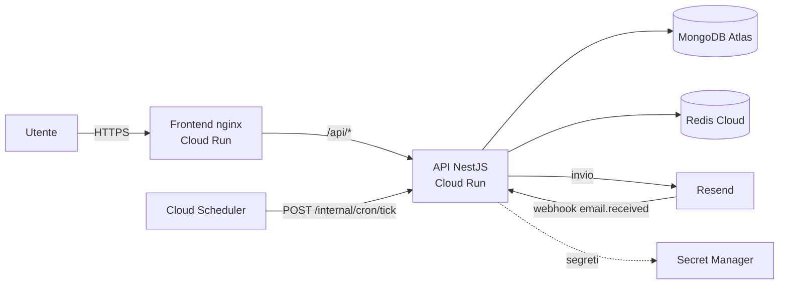

# 6 · Deploy

Questa guida descrive una messa in produzione su Google Cloud Run con MongoDB Atlas e Resend. Il servizio è
**stateless**: ogni istanza può nascere e morire in qualsiasi momento, e più istanze possono lavorare insieme.



## 1. Prerequisiti

- Progetto Google Cloud con Cloud Run, Artifact Registry, Secret Manager e Cloud Scheduler abilitati.
- Cluster MongoDB Atlas (anche M0/M10 per cominciare) con accesso di rete per Cloud Run.
- Istanza Redis (Redis Cloud o Google Memorystore) per la coda di invio asincrono BullMQ.
- Account Resend con dominio di invio e dominio di ricezione (vedi [Installazione](./05-installazione-e-configurazione.md#attivare-linvio-reale-con-resend)).
- Un dominio per l'applicazione, ad esempio `cancellamy.example.org`.

## 2. Immagini

Entrambi i repository hanno un `Dockerfile` multi-stage, eseguito come utente non root.

```bash
# Backend (ascolta su PORT, 8080 se non impostata)
docker build -t REGION-docker.pkg.dev/PROGETTO/cancellamy/backend:0.1.0 cancellamy-backend

# Frontend (nginx non privilegiato sulla porta 8080)
docker build -t REGION-docker.pkg.dev/PROGETTO/cancellamy/frontend:0.1.0 \
  --build-arg VITE_SOURCE_URL=https://github.com/<tu>/cancellamy cancellamy-frontend
```

Nota: i Dockerfile installano npm 11 prima di `npm ci` perché il lockfile è prodotto con quella versione.

## 3. Segreti

Crea i segreti in Secret Manager e montali come variabili d'ambiente:

| Segreto | Contenuto |
|---|---|
| `jwt-access-secret` | `openssl rand -base64 48` |
| `data-encryption-key` | `openssl rand -base64 32` (**conservane una copia offline**) |
| `mongodb-uri` | Stringa di connessione Atlas |
| `redis-url` | Stringa di connessione Redis (BullMQ) |
| `resend-api-key`, `resend-webhook-secret` | Da Resend |
| `cron-secret` | Una stringa casuale lunga |

## 4. Servizio API

```bash
gcloud run deploy cancellamy-api \
  --image REGION-docker.pkg.dev/PROGETTO/cancellamy/backend:0.1.0 \
  --region REGION --allow-unauthenticated \
  --min-instances 1 --max-instances 5 \
  --set-env-vars NODE_ENV=production,MAIL_MODE=dry-run,APP_URL=https://cancellamy.example.org,\
CORS_ORIGINS=https://cancellamy.example.org,TRUST_PROXY=true,SCHEDULER_ENABLED=false,\
MAIL_FROM='Cancellamy <richieste@example.org>',INBOUND_DOMAIN=in.example.org,\
OPERATOR_NAME='La tua organizzazione',SUPPORT_EMAIL=supporto@example.org,\
RESEND_DAILY_LIMIT=100,RESEND_MONTHLY_LIMIT=3000,USER_DAILY_REQUEST_LIMIT=5 \
  --set-secrets JWT_ACCESS_SECRET=jwt-access-secret:latest,DATA_ENCRYPTION_KEY=data-encryption-key:latest,\
MONGODB_URI=mongodb-uri:latest,REDIS_URL=redis-url:latest,RESEND_API_KEY=resend-api-key:latest,\
RESEND_WEBHOOK_SECRET=resend-webhook-secret:latest,CRON_SECRET=cron-secret:latest
```

Punti di attenzione:

- Parti con `MAIL_MODE=dry-run` e passa a `resend` solo dopo la checklist qui sotto.
- `--min-instances 1` evita avvii a freddo sul webhook delle risposte (facoltativo).
- **Pool di MongoDB:** ogni istanza apre fino a 10 connessioni (`maxPoolSize`). Dimensiona Atlas pensando a
  istanze × 10.
- **Avvio rapido e arresto ordinato:** l'app gestisce SIGTERM (chiude connessioni e attende il giro dello scheduler
  in corso) e non fa lavoro pesante all'avvio, a parte il caricamento del registry.
- **Health check:** `GET /health` (liveness) e `GET /health/ready` (ping di MongoDB).
- **Log:** JSON su stdout con campo `severity` (compatibile con Cloud Logging); le intestazioni `authorization` e
  `cookie` sono oscurate.

## 5. Scheduler (Cloud Scheduler)

Cloud Run limita la CPU quando non ci sono richieste, quindi i timer interni non sono affidabili. Usa Cloud
Scheduler per chiamare ogni minuto l'endpoint dei lavori:

```bash
gcloud scheduler jobs create http cancellamy-tick \
  --schedule="* * * * *" --location REGION \
  --uri="https://API_URL/internal/cron/tick" --http-method=POST \
  --headers="x-cron-secret=VALORE_DEL_SEGRETO"
```

Un giro: segna le richieste scadute, aggiunge i broker nuovi ai profili attivi, invia le email in coda, manda i
solleciti, crea i rinnovi e genera i report mensili. È **sicuro con più istanze e con chiamate duplicate**: un
"lease" su MongoDB lascia lavorare una sola istanza alla volta e ogni compito riserva atomicamente il proprio
lavoro, quindi nulla viene inviato due volte. (In alternativa, con CPU sempre allocata, lascia `SCHEDULER_ENABLED=true`.)

## 6. Frontend

Il container nginx serve l'app e inoltra `/api/` all'API, così il cookie di sessione resta same-origin.

```bash
gcloud run deploy cancellamy-web \
  --image REGION-docker.pkg.dev/PROGETTO/cancellamy/frontend:0.1.0 \
  --region REGION --allow-unauthenticated \
  --set-env-vars API_UPSTREAM=https://API_URL
```

Il container applica intestazioni di sicurezza (CSP restrittiva, `X-Frame-Options`, `nosniff`), cache immutabile per
`/assets/` e nessuna cache per `index.html`. Associa il dominio dell'applicazione a questo servizio.

Se preferisci servire i file statici altrove, instrada `/api` verso il backend sullo stesso dominio: con domini
diversi il cookie `cnc_rt` richiederebbe `SameSite=None; Secure` e altre cautele.

## 7. Webhook di Resend

Configura il webhook `email.received` verso `https://cancellamy.example.org/api/v1/webhooks/resend` (passa dal
frontend) oppure direttamente verso l'API. Il segreto va in `RESEND_WEBHOOK_SECRET`.

## Self-hosting con Docker Compose

Per chi vuole ospitare la propria istanza senza cloud gestito, la cartella `selfhost/` del backend contiene uno stack
completo: MongoDB, API e web app (nginx che inoltra `/api` all'API, così il cookie di sessione resta first-party).

```bash
cd cancellamy-backend/selfhost
cp selfhost.env.example .env        # imposta almeno JWT_ACCESS_SECRET e DATA_ENCRYPTION_KEY
docker compose up -d --build        # http://localhost:8080
```

- Il repository del frontend deve stare accanto a quello del backend (oppure imposta `FRONTEND_CONTEXT`).
- Le email restano in modalità prova finché non imposti `MAIL_MODE=resend` e le chiavi di Resend.
- Metti davanti un reverse proxy con TLS (Caddy, Traefik, il load balancer del tuo cloud), poi imposta `APP_URL` con
  l'indirizzo https e `COOKIE_SECURE=true`.
- Salva il volume `mongo-data` **e** la `DATA_ENCRYPTION_KEY`.
- Ogni funzione opzionale (violazioni, SMS, marca temporale) si accende con la sua variabile; senza, resta nascosta.
- Con una sola istanza dell'API basta lo scheduler interno (`SCHEDULER_ENABLED=true`, già impostato).

Lo stack è stato avviato e provato end to end (web → API → MongoDB, registry caricato, registrazione via proxy).

### Istanza pubblica ospitata da te

Il modello previsto dal progetto è una istanza pubblica gestita dal maintainer, con il codice aperto a chiunque. In
quel caso valgono tutte le attenzioni del capitolo [Sicurezza, privacy e aspetti legali](./09-sicurezza-privacy-legale.md)
(sei titolare del trattamento) e conviene: tenere attiva la verifica dei contatti prima di "Cosa sai di me", impostare
`LEADERBOARD_MIN_USERS` ad almeno 20, usare un'autorità di marcatura temporale affidabile per il dossier e non abilitare
SMS o violazioni senza aver letto i costi e i termini dei rispettivi fornitori.

## 8. Checklist prima di passare a `MAIL_MODE=resend`

- [ ] `DATA_ENCRYPTION_KEY` salvata fuori dal cloud e provata (hai una procedura di ripristino).
- [ ] Backup di MongoDB attivi (Atlas) e provati.
- [ ] Dominio di invio verificato (SPF/DKIM/DMARC) e `MAIL_FROM` corretto.
- [ ] Dominio di ricezione attivo, webhook configurato, **risposta di prova** ricevuta e collegata a una richiesta.
- [ ] Cloud Scheduler attivo e `POST /internal/cron/tick` risponde 200 col segreto (401 senza).
- [ ] `OPERATOR_NAME` e `OPERATOR_ADDRESS` reali: compaiono nella delega e nelle email ai broker.
- [ ] Pagine **Privacy** e **Termini** sostituite con testi rivisti da un legale; **DPIA** redatta
      (vedi [Sicurezza, privacy e aspetti legali](./09-sicurezza-privacy-legale.md)).
- [ ] Registry riletto: abilitati solo recapiti che accetti di usare. Prova con **un** broker.
- [ ] `VITE_SOURCE_URL` punta al repository che serve il codice (AGPL §13).
- [ ] Almeno un admin configurato (`ADMIN_EMAILS`) e account di prova eliminato.
- [ ] Monitoraggio e avvisi su errori 5xx, `/health/ready` e invii falliti (vedi [Operazioni](./10-operazioni.md)).
- [ ] Funzioni opzionali decise e configurate (`FEATURES_DISABLED`, `SMS_PROVIDER`, `HAVEIBEENPWNED_API_KEY`, `TSA_URL`) con i relativi contratti e costi.
- [ ] `LEADERBOARD_MIN_USERS` impostato a un valore che protegga davvero l'anonimato (almeno 20 su un'istanza pubblica).

## Aggiornamenti

1. Costruisci e pubblica le nuove immagini.
2. `gcloud run deploy` con il nuovo tag: Cloud Run sposta il traffico in modo graduale e invia SIGTERM alle vecchie
   istanze.
3. Il registry viene ricaricato all'avvio (le modifiche fatte dagli admin non vengono sovrascritte).
4. Non ci sono migrazioni di database manuali: gli indici sono creati da Mongoose all'avvio.

Un servizio **ospitato per terzi** comporta responsabilità di titolare del trattamento: leggi prima il capitolo
[Sicurezza, privacy e aspetti legali](./09-sicurezza-privacy-legale.md).
