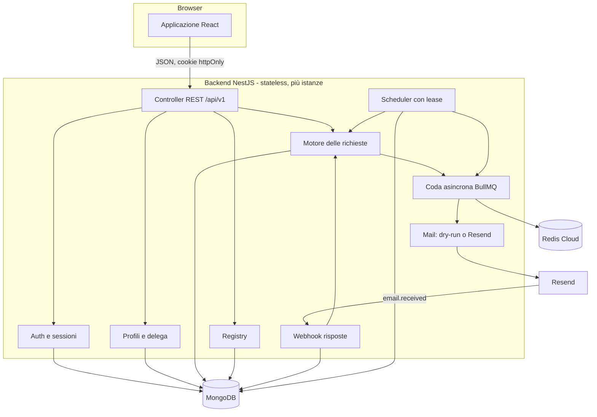

# 7 · Architettura

## Visione d'insieme

Principi di progetto:

- **Stateless.** Nessuno stato in memoria, nessun file locale persistente: tutto in MongoDB.
- **Idempotente.** Creazione richieste, invii, solleciti, rinnovi, webhook e ticks possono ripetersi senza effetti doppi.
- **Sicuro per impostazione predefinita.** Modalità prova, invio solo su recapiti `verified`, dati personali cifrati.
- **Configurazione solo da ambiente.** Segreti da Secret Manager, nessun file di configurazione in produzione.

## Struttura del codice (`cancellamy-backend/src`)

| Cartella | Responsabilità |
|---|---|
| `config/` | Lettura e validazione dell'ambiente (`app-config.ts`) |
| `db/` | Schemi Mongoose (`schemas.ts`) e `DbModule` |
| `common/` | Cifratura (`CryptoService`), orologio, errori, filtro eccezioni, paginazione |
| `auth/`, `users/` | Registrazione, login, refresh con rotazione, `/me`, esportazione, cancellazione account |
| `profiles/` | CRUD profili, dati cifrati, delega, PDF, attivazione, pausa |
| `brokers/` | Caricamento del registry, catalogo pubblico, modifiche admin |
| `requests/` | Pianificazione canale, macchina a stati, motore (invio, risposte, scadenze, rinnovi), azioni utente |
| `queue/` | Gestione code BullMQ, connessione Redis, invio a scaglioni e worker seriale (`DispatchQueueService`) |
| `inbound/` | Webhook di Resend, abbinamento delle risposte, posta non abbinata |
| `scheduler/` | Giri periodici con lease, endpoint `/internal/cron/tick` |
| `notifications/`, `reports/` | Notifiche in app e per email, report mensili |
| `sender/` | Invio dalla casella dell'utente: SMTP e Gmail (OAuth), protezione SSRF, instradamento (`OutboundService`), errori di mittente |
| `identity/` | Verifica del possesso di email e telefoni (codici), SMS (`dry-run`, Twilio) |
| `dossier/` | Dossier probatorio (ZIP con manifest SHA-256) e client RFC 3161 |
| `breaches/` | Controllo violazioni (Have I Been Pwned) |
| `delistings/` | Pratiche di deindicizzazione, guide per motore di ricerca |
| `nuisance/` | Contatti indesiderati, segnalazione al Garante, promemoria RPO |
| `leaderboard/` | Statistiche pubbliche aggregate per broker, con soglia di privacy |
| `pdf/`, `templates/` | PDF (delega, reclamo) e testi (email ai broker, delega, reclamo) |
| `mail/` | Trasporti `dry-run` e `resend`, email di sistema |
| `admin/`, `health/` | Area admin, health check |

Moduli Nest: `AppConfigModule`, `DbModule` e `MailModule` sono globali; `AuthModule`, `BrokersModule` e
`DomainModule` (profili, richieste, inbound, scheduler, notifiche, report, admin) completano l'applicazione.

## Modello dati (MongoDB)

| Collezione | Contenuto | Note |
|---|---|---|
| `users` | Email, hash della password (argon2id), ruolo, impostazioni, token di verifica/reset (hash), blocco accessi | Email univoca |
| `sessions` | Refresh token (solo hash), famiglia, scadenza, revoca, rotazione | Indice TTL sulla scadenza |
| `profiles` | Stato, **`pii` cifrato** (JSON), token dell'indirizzo di risposta | Mai dati personali in chiaro |
| `authorizations` | Delega firmata: data, **firma cifrata**, versione e impronta del testo, hash dell'IP, revoca | |
| `brokers` | Il registry in database: canali, stato di verifica, `sendEnabled`, campi modificati dall'admin | Slug univoco |
| `removalrequests` | Richiesta: broker, canale, stato, ciclo, date, cronologia, istruzioni manuali | Indice univoco profilo+broker+ciclo; codice `CNC-…` univoco |
| `messages` | Messaggi in entrata e in uscita: **oggetto e testo cifrati**, allegati (solo metadati), classificazione | |
| `mailquotas` | Contatori atomici con indice TTL per tracciare quote Resend (100/giorno, 3000/mese) e fair-share per utente (5/giorno) | |
| `unmatchedinbound` | Risposte non abbinate (oggetto e testo cifrati) | Per l'admin |
| `notifications`, `reports` | Notifiche e report mensili | Report univoco per profilo+periodo |
| `locks` | Lease dello scheduler | |
| `processedwebhooks` | Consegne del webhook già elaborate | Indice TTL 30 giorni |
| `attachmentfiles` | Allegati ricevuti dai broker, **cifrati** (iv, tag, testo cifrato) | Indice TTL su `expiresAt` |
| `contactcodes` | Codici di verifica dei contatti (solo hash), tentativi e limiti | Indice TTL |
| `breachchecks` | Email controllate (cifrate) e risultati per profilo | Univoco profilo+email |
| `delistings` | Pratiche di deindicizzazione | |
| `nuisancereports` | Contatti indesiderati: numero, società e descrizione **cifrati** | |

Identificatori: ObjectId di Mongo; il registry usa slug; le richieste hanno anche il riferimento `CNC-` + 8 caratteri
(alfabeto senza caratteri ambigui, ~10¹² combinazioni).

## Cifratura dei dati personali

`CryptoService` cifra a livello di campo con **AES-256-GCM** (IV casuale da 12 byte per ogni cifratura, tag di
autenticazione). Formato memorizzato: `v1:<iv>:<tag>:<testo cifrato>` in base64. La chiave è `DATA_ENCRYPTION_KEY`.
Sono cifrati: dati del profilo, firma della delega, oggetto e testo dei messaggi. Non lo sono: email dell'account
(serve per il login), codici di riferimento, indirizzi dei broker, date e stati.

La rotazione della chiave non è automatica: il prefisso `v1` serve a introdurre in futuro una versione successiva
(vedi [Operazioni](./10-operazioni.md#rotazione-dei-segreti)).

## Funzioni opzionali e flag

`computeFeatures(config)` (in `src/config/app-config.ts`) calcola i flag esposti da `GET /config`: una funzione è
attiva se non è in `FEATURES_DISABLED` e, per quelle che dipendono da un servizio esterno, se è configurato
(`HAVEIBEENPWNED_API_KEY`, `TSA_URL`, `SMS_PROVIDER`). I controller delle funzioni spegnibili sono marcati con
`@Feature('nome')`: un `FeatureGuard` globale risponde `404 FEATURE_DISABLED` quando sono spente. Il frontend legge i
flag e nasconde voci di menu, sezioni e link.

### Richieste, tipi e unicità

Una richiesta ha `kind` (`erasure` | `access`). L'unicità è (profilo, broker, **tipo**, ciclo), quindi una cancellazione
e un accesso verso lo stesso broker convivono. All'avvio `DbModule` elimina l'indice precedente (profilo, broker, ciclo)
dei database creati prima e crea quello nuovo.

### Instradamento dell'invio

`OutboundService` decide come parte un'email di un profilo: con `senderMode: 'smtp'` usa le impostazioni cifrate del
profilo (`SmtpSenderService`, nodemailer); con `senderMode: 'gmail'` usa il token di aggiornamento cifrato e l'API Gmail
(`GmailSenderService`); altrimenti il fornitore di Cancellamy. In modalità prova non apre nessuna connessione. Gli errori di autenticazione del mittente (`SenderAuthError`) non consumano tentativi: la richiesta resta in
coda, il profilo riceve un `senderError`, l'utente una sola notifica e i giri dello scheduler saltano il profilo finché
le impostazioni non vengono salvate di nuovo.

### Protezione SSRF dell'SMTP

Il server SMTP è scelto dall'utente: `net-guard.ts` rifiuta indirizzi privati, loopback, link-local, CGNAT, multicast e
IPv6 locali, risolve l'host **una sola volta** e si collega all'IP verificato (con `servername` per il TLS), così un
cambio di DNS tra controllo e connessione non aggira il filtro. Sono ammesse solo le porte 25, 465, 587 e 2525.

## Autenticazione e sessioni

- **Accesso:** JWT HS256 di **15 minuti** (`Authorization: Bearer`), tenuto in memoria dal frontend. Ad ogni richiesta
  l'utente viene riletto da database: un account eliminato o un cambio di ruolo hanno effetto subito.
- **Refresh:** token opaco casuale in cookie `cnc_rt` (`HttpOnly`, percorso `/api/v1/auth`, 30 giorni), salvato come
  hash. A ogni refresh viene **ruotato**.
- **Rilevamento del furto:** se un token già ruotato viene riusato dopo oltre 10 secondi, l'intera famiglia di
  sessioni viene revocata. Entro 10 secondi si tollera la doppia chiamata di due schede (si emette solo un nuovo
  accesso, senza nuovo cookie). Un token revocato da logout o reset non viene mai riaccettato.
- **Password:** argon2id; blocco di 15 minuti dopo 10 tentativi falliti; errori generici (non rivelano se l'email
  esiste); un confronto fittizio uniforma i tempi di risposta.
- **Limiti di frequenza:** 120 richieste/min per IP in generale, 10/min su registrazione, login, verifica e reset.

## Il motore delle richieste

`RequestEngine` (`src/requests/request-engine.ts`) concentra la logica che modifica lo stato:

- creazione idempotente (indice univoco + ritentativo se il codice `CNC-` collide);
- invio di prima richiesta, solleciti e documento d'identità con allegati;
- applicazione delle risposte (classificazione → stato → notifica);
- compiti dello scheduler: `claimQueued`, `deliverClaimed`, `markOverdue`, `sendDueReminders`, `createRenewals`,
  `syncNewBrokers`; in più il giro esegue i report mensili, i promemoria di deindicizzazione e RPO e le interrogazioni
  del controllo violazioni (poche per giro, lente);
- sospensione e riattivazione delle richieste legate alla delega.

`RequestsService` espone le azioni dell'utente (lista, riepilogo, dettaglio, azioni manuali, esiti, documento,
sollecito, reclamo, annulla, simulazione, richiesta personalizzata) usando il motore.

### Concorrenza e più istanze

- Lo scheduler acquisisce un **lease** (`locks`, durata 5 minuti) con una scrittura condizionale: solo un'istanza
  lavora per volta; le altre rispondono `ran: false`.
- Anche senza lease, ogni compito **riserva atomicamente** il suo lavoro (`findOneAndUpdate` con `lockedUntil`,
  cambi di stato condizionati): due istanze non inviano la stessa richiesta due volte.
- L'invio usa una **chiave di idempotenza** verso il fornitore email.
- Il webhook è deduplicato per id di consegna e per id del messaggio ricevuto.

Test dedicati lo verificano con due applicazioni sullo stesso database.

## Email

Il trasporto è scelto da `MAIL_MODE`:

- `dry-run`: non spedisce, restituisce un id sintetico (`dry_…`) e, a livello `debug`, scrive il corpo nel log;
- `resend`: usa la libreria ufficiale di Resend, con chiave di idempotenza, `reply-to`, intestazione
  `X-Cancellamy-Ref`, etichetta `request` e allegati. Gli errori sono classificati **transitori** (rete, 429, 5xx) o
  **permanenti** (4xx).

Le email di sistema (verifica, reset, notifiche) usano lo stesso trasporto con un modello HTML minimale.

### Gestione code asincrone e quote (BullMQ + Redis)

L'invio delle richieste non avviene in modo sincrono o con burst incontrollati:
- **Coda BullMQ (`request-dispatch`):** I compiti di invio sono persistiti su Redis Cloud (`ioredis`) e processati da un Worker con concorrenza 1 e limitatore a 600 ms per richiesta (pieno rispetto dei rate limit dell'API Resend).
- **Politica Fair-Share:** Ogni utente riceve al massimo **5 invii automatici al giorno**. Le richieste in eccesso vengono programmate su Redis con ritardi giornalieri progressivi (`scheduledAt` differito di 24h, 48h, ecc.).
- **Guardia delle quote globali Resend:** Monitoraggio continuo dei tetti di **100 email/giorno** e **3000 email/mese**, con riserva di 5 email/giorno per garantire il recapito di email critiche (codici di verifica, link di reset password). Se la quota giornaliera di invio massivo (95) viene raggiunta, i job BullMQ rimandano automaticamente l'esecuzione al giorno successivo a mezzanotte UTC.

## Frontend

Applicazione a pagina singola in `cancellamy-frontend`:

- **Stack:** React 19, TypeScript strict, Vite 7, React Router 7, TanStack Query 5, react-hook-form + zod, Tailwind 4.
- **Struttura:** `src/api` (client tipizzato e hook), `src/features/*` (auth, shell, pubblico, broker, dashboard,
  richieste, profili, report, notifiche, impostazioni, admin), `src/i18n/it.ts` (tutti i testi in italiano),
  `src/lib` (formati, mappature di stato).
- **Contratto:** i tipi in `docs/api-types.ts` sono copiati identici in `src/api/types.ts`; il client è un solo
  livello, così un cambio di contratto tocca pochi file.
- **Sessione:** il token di accesso è in memoria; al caricamento dell'app si tenta il refresh dal cookie; un 401
  provoca un refresh e un solo nuovo tentativo, poi l'uscita.
- **Nessuna dipendenza esterna a runtime:** niente CDN, font esterni o analytics. Il container nginx applica una CSP
  restrittiva.
- **Percorsi:** pubblici (`/`, `/come-funziona`, `/broker`, `/privacy`, `/termini`, `/accedi`, `/registrati`,
  `/verifica-email`, `/password-dimenticata`, `/reimposta-password`), area utente (`/app`, `/app/richieste`,
  `/app/richieste/nuova`, `/app/richieste/:id`, `/app/profili`, `/app/profili/nuovo`, `/app/profili/:id`,
  `/app/report`, `/app/notifiche`, `/app/impostazioni`) e admin (`/app/admin`, `/app/admin/broker`,
  `/app/admin/posta-non-abbinata`, `/app/admin/posta-inviata`).

## Scelte tecniche da conoscere

- **NestJS 11, non 12:** la 12 è solo ESM e `@nestjs/swagger` non supporta ancora TypeScript 7; si usano NestJS 11 e
  TypeScript 5.9.
- **Webhook:** si usa la libreria `standardwebhooks` (CJS) invece di `svix` (solo ESM, non compatibile con Jest).
- **Registry in file, non in database:** il file nel repository è la fonte di verità, versionabile e rivedibile con
  pull request; il database ne è una copia operativa con le modifiche degli admin.
